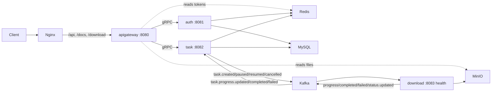

# Architecture overview

## Purpose
goload is a download manager: users submit a source (HTTP/HTTPS, FTP, BitTorrent magnet/.torrent), the system downloads it server-side, stores it in object storage, and serves it back through a short-lived URL.

## Deployment modes
| Mode | Entry point | Wiring |
|---|---|---|
| Microservices | `cmd/apigateway`, `cmd/auth/svc`, `cmd/task`, `cmd/download` | gRPC + Kafka + MySQL + Redis + MinIO ([docker-compose](../../deployments/docker-compose.yaml)) |
| Pocket | [cmd/pocket](../../cmd/pocket/main.go) | One process, SQLite, in-memory broker, local FS, no auth (fixed `pocket` account) |
| Pocket server | [cmd/pocketsrv](../../cmd/pocketsrv/main.go) | One process, SQLite, in-memory broker, local FS, real JWT auth |

Pocket modes reuse the same `internal/*` packages with different adapters. They are composition roots, not services. See [services/pocket.md](../services/pocket.md).

## Service map

## Communication
| Kind | Path | Notes |
|---|---|---|
| Sync | gateway → auth (`VerifySession` on every protected request) | gRPC, no deadline, no retry |
| Sync | gateway → task (all task ops + `GetTask` ownership check) | gRPC, no deadline, no retry |
| Async | task ↔ download | Kafka, JSON payloads from [internal/events](../../internal/events/event.go), 1 partition per topic |
| Shared data | gateway reads task's Redis tokens and download's MinIO bucket directly | Violates data ownership. See [service-catalog](service-catalog.md) |

Download never calls task over gRPC; all task-state updates travel as Kafka events.

## Main business flows
Detailed in [data-flows.md](data-flows.md):
1. Register and log in
2. Authenticated task request (auth + ownership)
3. Create task → download → complete
4. Pause / resume / cancel
5. Fetch a completed file

## Known structural gaps
- No Kubernetes manifests yet (target platform: [ADR-0006](../adr/0006-kubernetes-deployment.md)). Only docker-compose for local use.
- No service discovery: addresses are static env vars (`AUTH_SERVICE_GRPC_ADDRESS`, `TASK_SERVICE_GRPC_ADDRESS`).
- No distributed tracing, no metrics (target: [ADR-0007](../adr/0007-observability-otel-prometheus.md)). Request ID exists at the HTTP edge only and is not propagated over gRPC or Kafka.
- No CI pipeline and no `make test` target.
- auth and task share one MySQL database locally ([ADR-0009](../adr/0009-local-shared-mysql.md)); production is DB-per-service ([ADR-0001](../adr/0001-database-per-service.md)).
- No outbox yet ([ADR-0003](../adr/0003-transactional-outbox.md)): events are published inside DB transactions ([data-flows #3](data-flows.md#3-create-task--download--complete)).
- Download consumer Ack policy target: after completion ([ADR-0004](../adr/0004-consumer-ack-after-completion.md)).

Further reading: [standards](../standards/) · [research](../research.md) · [legacy map](../ai/legacy-map.md).
